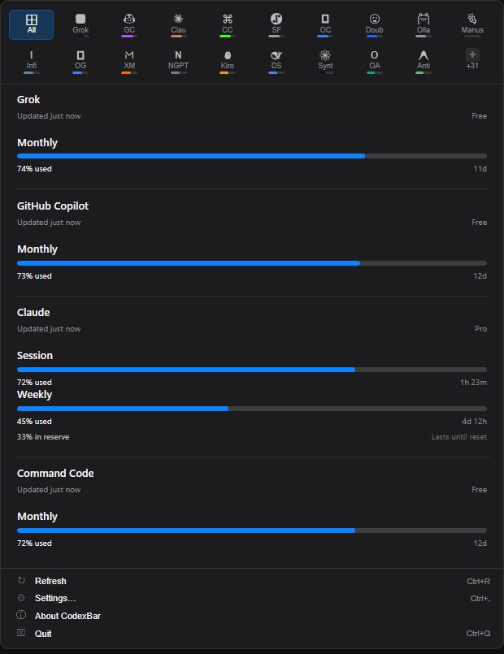
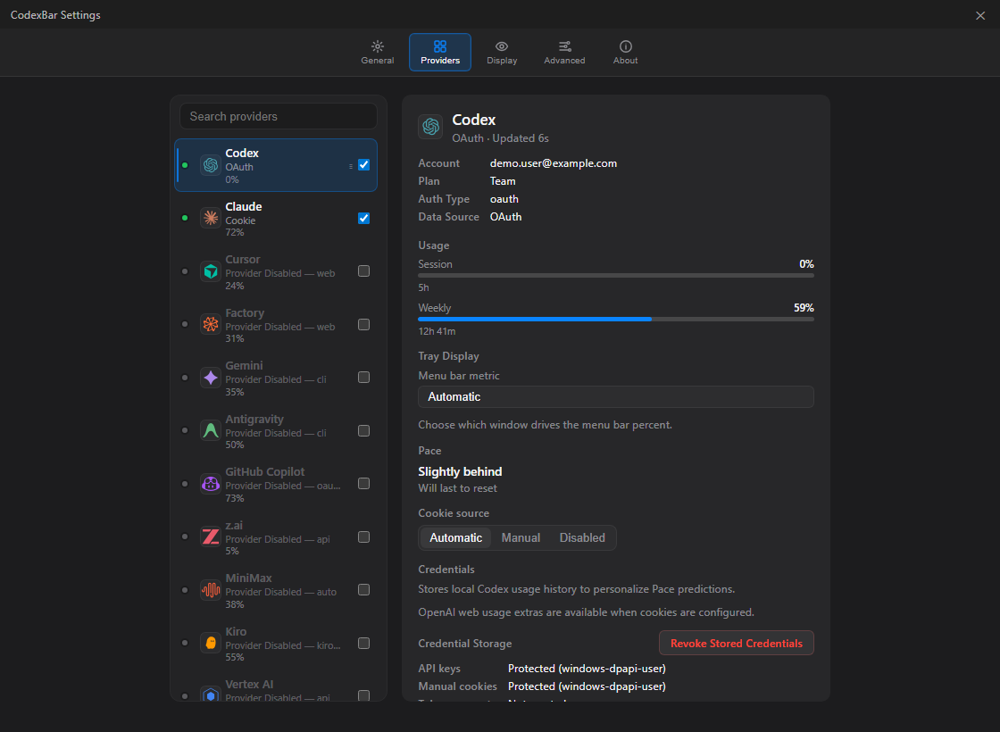

# TokenBar

[English](./README.md) | [简体中文](./README.zh-CN.md) | [繁體中文（臺灣）](./README.zh-TW.md) | [日本語](./README.ja-JP.md) | [한국어](./README.ko-KR.md) | [Español mexicano](./README.es-MX.md)

TokenBar is a Windows system-tray app for keeping AI coding-tool usage visible without opening a dozen dashboards. It ports the spirit of [CodexBar](https://github.com/steipete/CodexBar) to a Tauri + React desktop shell backed by shared Rust provider logic.

<table>
  <tr>
    <td width="36%" align="center">
      
    </td>
    <td width="64%" align="center">
      
    </td>
  </tr>
</table>

## Highlights

- **59 providers** including Codex, Claude, Copilot, OpenRouter, Cursor, Gemini, DeepSeek, MiniMax, Kiro, Antigravity, Groq, Qoder, Sakana AI, CrossModel, and more.
- **Tray-first workflow** with a compact provider grid, usage cards, refresh action, settings shortcut, and quit control.
- **Provider settings** for source selection, credentials, cookie import, token accounts, API keys, regions, and tray-display preferences.
- **Windows credential protection** for app-managed API keys, manual cookies, and token accounts, using user-scoped DPAPI where available.
- **Saved-session cookies by default**: web-session providers read the cookie you saved or
  imported; automatic browser-cookie reading (Chrome/Edge/Brave/Firefox and other readable
  profiles) is a per-provider opt-in.
- **Installed local CLI** for scripting usage, cost, config, diagnostics, and loopback integrations.
- **Installer + portable builds** with WebView2 runtime bootstrap, VC++ runtime bootstrap, and SHA-256 checksum files.

## Install

Download the installer or portable build from [TokenBar GitHub Releases](https://github.com/shawnqd/TokenBar/releases).

- Installer: `CodexBar-<version>-Setup.exe`
- Portable: `CodexBar-<version>-portable.exe`
- Checksums: each release includes `.sha256` files

Winget distribution is not enabled for the TokenBar fork yet; do not use the historical Win-CodexBar package identifier.

### macOS

TokenBar ships for Windows only. For the macOS app, installation instructions
and current features, use the original CodexBar directly:

<https://github.com/steipete/CodexBar>

## First Run

1. Launch **TokenBar** from the Start Menu or portable executable.
2. Click the tray icon to open the usage panel.
3. Open **Settings -> Providers**.
4. Enable the providers you use.
5. Add only the credential the provider supports. Web-session providers read the session
   cookie you saved or imported; automatic browser-cookie reading is opt-in per provider via
   its read-source setting. API keys and provider-specific CLI/OAuth login remain separate.

For Claude, automatic browser cookies/sessionKey are preferred because they match Claude's
settings-page usage. Manual Cookie addition is only a fallback. OAuth and CLI stay available
where the provider supports them. For CLI-based providers such as Codex and Gemini, sign in
with the provider CLI first.

## Latest Release

**v0.57.3** is the current Windows release, with isolated development/stable startup identities and a Simplified Chinese installer aligned to the TokenBar repository.

See the full history in [CHANGELOG.md](CHANGELOG.md).

## Supported Providers

<details>
<summary>Provider matrix</summary>

| Provider | Auth | Tracks |
|---|---|---|
| Codex | OAuth / CLI | Session, Weekly, Credits |
| Claude | Cookies / OAuth fallback / CLI fallback | Session (5h), Weekly |
| Cursor | Cookies | Plan, Usage, Billing |
| Factory | Cookies | Usage |
| Gemini | gcloud OAuth | Quota |
| Copilot | GitHub Device Flow / gh CLI / legacy token | Plan usage, Chat |
| Antigravity | Local LSP | Usage, Per-model quotas |
| z.ai | API Token | Quota |
| MiniMax | API / Cookies | Usage, Billing Summary |
| Kiro | Cookies / CLI | Monthly Credits, Overage |
| Vertex AI | gcloud OAuth | Cost |
| Augment | Cookies | Credits |
| OpenCode | Local Config | Usage |
| Kimi | Cookies | 5h Rate, Weekly |
| Kimi K2 | API Key | Credits |
| Amp | Cookies | Usage |
| Warp | Local Config | Usage |
| Ollama | Cookies / API Key | Usage, Cloud Models, Pace windows |
| Azure OpenAI | API Key | Deployment |
| T3 Chat | Cookies / cURL | Base, Overage |
| OpenRouter | API Key | Credits |
| JetBrains AI | Local Config | Usage |
| Alibaba | Cookies | Usage |
| Alibaba Token Plan | Cookies | Token Plan Credits, Reset date |
| NanoGPT | API Key | Credits |
| Infini | API Key | Session, Weekly, Quota |
| Perplexity | Cookies | Credits, Plan |
| Abacus AI | Cookies | Credits |
| Mistral | Cookies | Billing, Usage |
| OpenCode Go | Cookies | Usage, Zen Balance |
| Kilo | API Key / CLI | Usage |
| Codebuff | API Key / Local Config | Credits, Weekly |
| DeepSeek | API Key | Balance, Usage summaries, Cost |
| Windsurf | Local Cache | Daily, Weekly |
| Manus | Cookies | Credits, Refresh Credits |
| MiMo | Cookies | Token Plan usage, account balance, plan label, reset date |
| Doubao | API Key | Request Limits |
| Volcengine Ark Coding Plan | Access Key / Secret Key | 5-hour, Weekly, Monthly quota |
| Volcengine Ark Agent Plan | Access Key / Secret Key | 5-hour, Daily, Weekly, Monthly AFP quota |
| Command Code | Cookies | Monthly Credits, Purchased Credits |
| Crof | API Key | Credits, Request Quota |
| StepFun | Oasis Token | 5h, Weekly, Token refresh |
| Venice | API Key | USD / DIEM Balance |
| OpenAI | Admin API / API Key | Usage, Requests, Project-scoped cost, Credit Balance |
| Grok | Cookies / auth.json | Billing |
| ElevenLabs | API Key | Subscription Credits, Voice Slots |
| Deepgram | API Key | Project Usage |
| Groq | API Key | Enterprise Metrics |
| LLM Proxy | API Key | Quota Stats |

</details>

The three Volcengine entries are intentionally separate: **Doubao** is the
request-limit probe, **Volcengine Ark Coding Plan** reads Coding Plan quota,
and **Volcengine Ark Agent Plan** reads AFP quota. They are not browser-cookie
providers and should be configured with the matching Ark credentials.

MiMo is shown as one Cookie-backed provider card: the same account session
supplies Token Plan usage and the console account balance. The legacy MiMo
API-key probe is not a separate quota card and is not required to read that
balance. The official `tp-...` Token Plan key is an inference credential, not
a public quota API.

## Supported Languages

The UI and contributor reporting currently support:

- English
- 简体中文
- 繁體中文（臺灣）
- 日本語
- 한국어
- Español mexicano

## Build From Source

```powershell
# Prerequisites: Node.js + pnpm. Rust and MinGW are installed by the script when needed.
git clone https://github.com/Finesssee/Win-CodexBar.git
cd Win-CodexBar
.\scripts\dev.ps1
```

For Windows hot-reload development, use the single-entry launcher instead:

```powershell
.\scripts\dev-windows.ps1
```

For a no-console double-click launch, open `scripts\dev-windows.vbs`; it
forwards to the same launcher with a hidden window.

It cleans up only TokenBar processes from this checkout, then starts one hidden
`tauri dev` chain (including Vite). Use `-DryRun` to inspect the cleanup set
without changing process state. Logs are written to `%TEMP%\tokenbar-dev\` so
the launcher does not open an additional console window or duplicate the tray
instance.

### Verify the app really started

Do not use `pnpm dev`, `tauri dev`, or a standalone `target\debug\codexbar-desktop-tauri.exe`
for interactive verification. The launcher is successful only when all of these are true:

- one checkout-scoped `codexbar-desktop-tauri.exe` is running from this repository's `target\`;
- Vite is listening on `127.0.0.1:1420` from this repository;
- the Tauri process is responsive or its window/tray is visible;
- `%TEMP%\tokenbar-dev\tauri-dev.stdout.log` contains Vite `ready` and
  `%TEMP%\tokenbar-dev\tauri-dev.stderr.log` contains the Tauri `Running` line.

If a chain is already running, verify and reuse it instead of starting another one. To restart cleanly:

```powershell
.\scripts\dev-windows.ps1 -StopOnly
.\scripts\dev-windows.ps1 -Verbose
```

Record the command, working directory, launcher PID, Tauri PID, executable path, Vite port and log tail
in the handoff. A build finishing or Vite becoming ready alone is not proof that the desktop app is running.

Useful dev flags:

```powershell
.\scripts\dev.ps1 -Release      # optimized build
.\scripts\dev.ps1 -SkipBuild    # relaunch the last build
```

CLI examples:

```bash
codexbar-cli --help
codexbar-cli diagnose --pretty
codexbar-cli usage -p claude
codexbar-cli usage -p all
codexbar-cli cost -p codex
```

Installer builds include `codexbar.exe` as the tray app and `codexbar-cli.exe` as the console CLI. Start Menu shortcuts launch the desktop app; terminal commands use `codexbar-cli.exe`. `codexbar-desktop.exe` is still installed as a compatibility alias for older shortcuts and autostart entries.

## Release Builds

For local Windows release builds, use the cached release builder:

```powershell
.\scripts\windows-release-build.ps1 -Ref v0.57.3 -SmokeInstall
```

The script builds the real Tauri release binary plus the console CLI, verifies signed installer dependencies, packages with Inno Setup, writes installer/portable assets, writes SHA-256 sidecars, and can run a silent install/uninstall smoke test.

More release automation notes live in [docs/release/ci-cd.md](docs/release/ci-cd.md).

## Privacy

- **On-device by default**: provider data is read from known local paths or provider APIs you configure.
- **Scoped automatic cookies**: browser-cookie extraction only runs for providers you enable;
  manual Cookie values remain an explicit fallback.
- **Protected secrets**: API keys, manual cookies, and token accounts use the secure-file layer; Windows uses user-scoped DPAPI where available.
- **Safe diagnostics**: diagnostics expose provider/source/status metadata only, never raw cookies, API keys, bearer tokens, or OAuth values.
- **Verified updates**: installer downloads require a GitHub SHA-256 digest and are re-verified immediately before apply.

## Docs

| Topic | Link |
|---|---|
| Building from source | [docs/BUILDING.md](docs/BUILDING.md) |
| WSL setup and auth tips | [docs/WSL.md](docs/WSL.md) |
| Browser cookie details | [docs/COOKIES.md](docs/COOKIES.md) |

## Credits

- Original project: [steipete/CodexBar](https://github.com/steipete/CodexBar) by Peter Steinberger
- Inspired by [ccusage](https://github.com/ryoppippi/ccusage) for cost tracking

## License

MIT, same as the original CodexBar.
